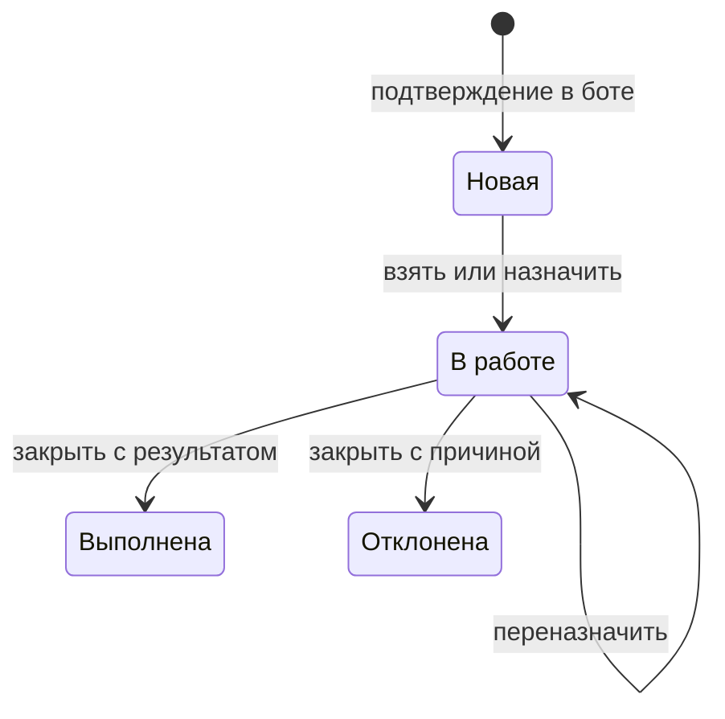
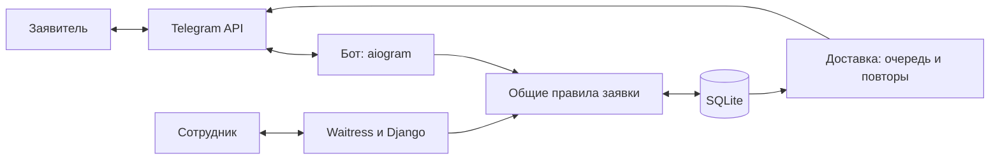

# Служба заявок

Система приёма и обработки обращений по помещениям и оборудованию учебного заведения. Заявитель подаёт обращение через Telegram, сотрудник обрабатывает его в веб-панели, результат возвращается заявителю сообщением в чат.

**Полный цикл:** заявка → номер → назначение сотрудника → выполнение или отклонение с результатом → уведомление заявителя.

Telegram выбран как разрешённая в ТЗ альтернатива MAX. Реализация собственная; готовые тикет-системы не используются. Для локальной работы достаточно Python и доступа к Telegram API, платные сервисы не обязательны.

[Требования](docs/requirements.md) · [Матрица приёмки](docs/acceptance.md) · [Инструкция оператора](docs/operator.md) · [Размещение](docs/hosting.md)

## Какую проблему решает

| Проблема | Решение в проекте | Результат |
| --- | --- | --- |
| Обращения теряются в переписке | Каждая подтверждённая заявка сохраняется в общей БД | У обращения есть номер, категория, описание и контакт |
| Неясно, кто занимается проблемой | Назначение и переназначение сотрудника | В карточке видны исполнитель и история действий |
| Заявителю приходится спрашивать о ходе работ | Уведомления о статусе и команда `/status` | Статус и результат доступны в Telegram |
| Сотрудники одновременно меняют одну заявку | Транзакции и проверка версии карточки | Устаревшее действие отклоняется с просьбой обновить данные |
| Временный сбой Telegram теряет сообщение | Сохраняемая очередь с повторными попытками | Неотправленное задание остаётся в БД после перезапуска |

## Сценарий работы

Пример обращения; номер зависит от базы данных.

| Шаг | Действие | Видимый результат |
| --- | --- | --- |
| 1 | Заявитель отправляет `/start`, выбирает подачу заявки | Приветствие и пошаговая анкета |
| 2 | Выбирает «Оборудование → Проектор» | Выбрана категория |
| 3 | Вводит «В кабинете 205 нет изображения» и контакт | Бот показывает данные перед подтверждением |
| 4 | Подтверждает заявку | Получает номер, например `З-000001`, и статус «Новая» |
| 5 | Оператор обновляет ленту и берёт заявку | Исполнитель назначен, статус «В работе», создано уведомление |
| 6 | Переназначает другому сотруднику | Смена исполнителя сохранена в истории |
| 7 | Сотрудник пишет «Заменён кабель» и отмечает выполнение | Статус «Выполнена», результат сохранён и поставлен на отправку |
| 8 | Заявитель получает сообщение, открывает «Статус заявки» или отправляет `/status З-000001` | Видит сведения о своей заявке |



Кнопка «Статус заявки» открывает список своих обращений по пять на странице. По номеру открывается краткая карточка с категорией, описанием, статусом и первыми восемью событиями истории. Полная история с авторами и временем доступна сотрудникам в веб-панели.

Закрытые заявки повторно не открываются. Переназначение добавляет событие истории, но не меняет статус и не создаёт уведомление о его смене.

### Возможности по ТЗ

| Критерии | Реализация |
| --- | --- |
| B01–B02 | Приветствие; группа → элемент → описание → контакт → подтверждение |
| B03 | Начальный классификатор: три группы по три элемента |
| B04–B06 | Уникальный номер, сохранение, список своих заявок и `/status`, возврат назад, проверка пустого ввода |
| W01–W02 | Вход сотрудников, общая лента, фильтры по статусу, группе, исполнителю и датам создания; по 25 заявок на странице |
| W03–W07 | Серверная проверка переходов, взятие, назначение, переназначение, обязательный результат при закрытии |
| W08 | Карточка с датой, категорией, описанием, заявителем, контактом, исполнителем и историей с авторами и временем |
| W09–W10 | Управление сотрудниками и классификатором; статистика по статусам и категориям |
| I01–I03 | Общая БД, очередь Telegram-уведомлений, повторы и контроль задержки доставки |
| D01–D06 | Бот и веб-панель, сценарий демонстрации, архитектура, инструкция оператора и воспроизводимый замер |
| T01–T03 | Локальный запуск, SQLite, открытые библиотеки, собственная логика обработки заявок |

Способы проверки каждого критерия, фактические результаты и ограничения — в [матрице приёмки](docs/acceptance.md).

| Группа | Начальные элементы |
| --- | --- |
| Оборудование | Проектор, принтер, компьютерный класс |
| Помещение | Кабинет, коридор, столовая |
| Обслуживание | Wi-Fi, электрика, мебель |

## Роли и доступ

| Участник | Права |
| --- | --- |
| Заявитель | Подача через личный чат, получение уведомлений, запрос статуса только своих заявок |
| Оператор | Просмотр и обработка всех заявок: взять, назначить, переназначить, закрыть |
| Администратор | Права оператора, статистика, управление справочниками и обычными сотрудниками |
| Главный оператор | Права администратора, создание операторских и администраторских доступов в `/team/` |

Все активные сотрудники работают с общей лентой. Проверки прав выполняются на сервере. Обычный администратор не может выдавать администраторские права, изменять других администраторов или отключать главного оператора.

## Архитектура и стек



Бот и веб вызывают общие функции `app/core/services.py` и используют один `DATABASE_PATH`. Передача заявок между ними происходит через БД. `run.py` выполняет подготовку и запускает приложение **в одном процессе Python**: Waitress работает в отдельном потоке, бот и доставка уведомлений — как асинхронные задачи. Дополнительные `runbot` и `notify` при таком запуске не нужны.

| Слой | Технологии | Причина выбора |
| --- | --- | --- |
| Сервер | Python 3.12+, Django 5.2.18 | ORM, миграции, формы, шаблоны, сессии и админка в одном фреймворке |
| Бот | aiogram 3.31.0, asyncio, long polling | Работа через Telegram API без входящего webhook |
| Данные | SQLite, транзакции IMMEDIATE | Файловая БД без отдельного сервера для локального прототипа |
| HTTP и статика | Waitress 3.0.2, WhiteNoise 6.12.0 | Запуск веб-панели и выдача готовых CSS/JS |
| Интерфейс | Django Templates, React, TypeScript, Tailwind CSS, shadcn/Radix UI | Серверные формы и интерактивные графики |
| Графики и оформление | Bklit, D3, Lucide, Motion for React, Anime.js, Number Flow | Статистика, иконки и анимации с учётом reduced-motion |
| Сборка и настройки | Vite, pnpm, python-dotenv | Готовые клиентские файлы и конфигурация через окружение |
| Размещение | ApexNodes, Pterodactyl; Cloudflare — вариант HTTPS | Контейнер Python, HTTP на порту 10064, при необходимости внешний HTTPS-прокси |

Django выбран вместо предложенной стартовой связки FastAPI/SQLAlchemy, чтобы объединить авторизацию, данные и серверный интерфейс. React подключён к графикам; вход и операции с заявками работают без JavaScript. Отдельный Node-сервер не нужен.

### Данные и надёжность

| Сущности / механизм | Назначение |
| --- | --- |
| `CategoryGroup → CategoryItem → Ticket` | Группа, элемент классификатора и заявка |
| `User`, `History` | Сотрудники, исполнитель, авторы и последовательность событий |
| `Notification` | Текст, число попыток, последняя ошибка, время отправки и следующей попытки |
| `BotDialog`, `BotCursor` | Черновик, идентификатор редактируемого сообщения и позиция обработки обновлений Telegram |
| Транзакция изменения | Статус, история и задание на уведомление сохраняются вместе или откатываются вместе |
| Версия заявки и уникальный ключ подтверждения | Защита от устаревших действий сотрудников и повторной подачи одной заявки |
| Снимки названий и отключение вместо удаления | Старые категории и авторы остаются понятными после изменений справочников и сотрудников |

Пароли хешируются средствами Django. Веб-формы защищены CSRF, пользовательский HTML экранируется. Токен, секреты, рабочие базы и логи исключены из Git.

## Локальный запуск с нуля

Требуются **Python 3.12+**, Git и доступ к Telegram API. Команды ниже — для Windows PowerShell. Node.js нужен только при изменении клиентских исходников.

### 1. Установить зависимости

```powershell
git clone --branch prototype https://github.com/MidoriMacbook/tgbot.git
cd tgbot
python -m venv .venv
.\.venv\Scripts\python.exe -m pip install -r requirements.lock
Copy-Item .env.example .env
```

Для Linux используются `cp .env.example .env` и путь `.venv/bin/python` вместо `.venv\Scripts\python.exe`.

### 2. Настроить `.env`

Создайте бота через `/newbot` у [BotFather](https://t.me/BotFather). В локальном `.env` заполните:

| Переменная | Что указать |
| --- | --- |
| `TELEGRAM_BOT_TOKEN` | Выданный BotFather токен |
| `TELEGRAM_BOT_USERNAME` | Имя своего бота без `@` |
| `DJANGO_SECRET_KEY` | Собственную случайную строку вместо значения из примера |
| `CHIEF_OPERATOR_EMAIL` | Почта главного оператора. Код с почты принимает только этот адрес |

Случайную строку для `DJANGO_SECRET_KEY` можно получить локально:

```powershell
.\.venv\Scripts\python.exe -c "import secrets; print(secrets.token_urlsafe(48))"
```

Для работы на своём компьютере замените сетевые параметры из образца на:

```dotenv
HOST=127.0.0.1
PORT=8000
PUBLIC_URL=http://127.0.0.1:8000
DJANGO_ALLOWED_HOSTS=localhost,127.0.0.1
DJANGO_CSRF_TRUSTED_ORIGINS=http://127.0.0.1:8000,http://localhost:8000
DJANGO_SECURE_COOKIES=0
DJANGO_COOKIE_SAMESITE=Lax
TELEGRAM_MINIAPP_ENABLED=0
TELEGRAM_ALLOW_EMBED=0
```

`.env` автоматически читается из корня проекта; уже заданные переменные окружения имеют приоритет. Подстановки и команды из файла не выполняются. Секреты не добавляйте в Git. После изменения настроек перезапустите приложение.

### 3. Запустить систему

```powershell
.\.venv\Scripts\python.exe run.py
```

При первом запуске применяются миграции, загружается классификатор 3×3, создаётся главный оператор и собирается статика. Затем сайт, бот и доставка уведомлений работают в одном процессе Python. При следующих запусках существующие данные и пароль сохраняются.

| Где проверить | Ожидаемый результат |
| --- | --- |
| `http://127.0.0.1:8000/` | Форма входа; после входа — лента заявок |
| Личный чат своего бота, `/start` | Приветствие и меню подачи |
| Подтверждение обращения в боте, затем обновление ленты | Один и тот же номер и описание |
| Взятие и закрытие заявки с результатом | История в карточке и сообщения в Telegram |

Для остановки нажмите `Ctrl+C`. Автоматического перезапуска приложения нет. Заявки, черновики и очередь сохраняются в БД.

### 4. Выдать доступ сотрудникам

Главный оператор входит по коду на `CHIEF_OPERATOR_EMAIL`. Администраторы входят логином и паролем. В **«Доступ сотрудников»** (`/team/`) создаются только администраторы.

Повторный запуск не сбрасывает пароль главного оператора. Смена существующего пароля:

```powershell
.\.venv\Scripts\python.exe manage.py changepassword admin
```

Если выбран другой логин, замените `admin`. Управление классификатором, данными и активностью сотрудников находится в `/admin/`.

### Отдельная демонстрация без Telegram

Вместо основного запуска, после настройки локального `.env`, можно создать отдельную БД с девятью заявками и двумя операторами. Команда `seed_demo` запросит пароль демонстрационных сотрудников.

```powershell
$env:DATABASE_PATH = 'demo.sqlite3'
$env:RUN_BOT = '0'
$env:RUN_NOTIFICATIONS = '0'
.\.venv\Scripts\python.exe manage.py migrate
.\.venv\Scripts\python.exe manage.py seed_demo
.\.venv\Scripts\python.exe run.py
```

Операторы: `operator1`, `operator2`. Повторный `seed_demo` не создаёт те же записи заново. У этих заявок Telegram ID `0`: доставку `notify` для них не запускают. Для живого полного цикла нужна заявка настоящего пользователя. Переменные этого примера действуют в текущем терминале; для основного запуска откройте новый.

## Настройка и размещение

Все параметры перечислены в [.env.example](.env.example).

| Настройки | Что меняют |
| --- | --- |
| `DATABASE_PATH` | Путь общей БД, по умолчанию `data.sqlite3` в корне проекта |
| `RUN_WEB`, `RUN_BOT`, `RUN_NOTIFICATIONS` | Включение компонентов единого запуска |
| `AUTO_MIGRATE`, `AUTO_BOOTSTRAP_CHIEF`, `AUTO_COLLECTSTATIC` | Автоматическую подготовку при запуске |
| `TELEGRAM_TEXTS`, `TELEGRAM_BUTTON_LABELS`, `TELEGRAM_LOWER_BUTTONS` | Тексты и состав меню бота |
| `TELEGRAM_BUTTON_STYLES`, `TELEGRAM_EMOJI`, `TELEGRAM_CATEGORY_ICONS` | Поддерживаемые цвета кнопок и иконки; при недоступном Premium используются обычные эмодзи |
| `TELEGRAM_NOTIFY_*`, `TELEGRAM_LEASE_SECONDS`, `TELEGRAM_RETRY_MAX_SECONDS` | Интервалы, таймауты, размер прохода очереди, аренду и повторы |

Для **ApexNodes / Pterodactyl** подготовлены Python egg, `HOST=0.0.0.0`, порт `10064`, узел `c-pl-2.apexnodes.xyz` и `PUBLIC_URL=http://pur3.me:10064`. Команда запуска — `python run.py`; зависимости устанавливаются из `requirements.lock`. Готовый frontend уже включён в репозиторий. Отдельные `runbot` и `notify` на контейнере не запускайте.

Текущая схема в документации — прямой HTTP: DNS указывает адрес сервера, пользователь открывает `http://pur3.me:10064`, прокси Cloudflare выключен. HTTP не шифрует логин, пароль и данные заявок. Для доступа по HTTPS описан отдельный вариант с Cloudflare и Origin Rule на порт `10064`; в режиме Flexible участок Cloudflare → контейнер остаётся HTTP. Настройки удалённого размещения и доступность домена отдельно не проверялись при подготовке README. [Пошаговое размещение](docs/hosting.md).

В текущем боте ссылки на панель нет: сотрудники открывают `PUBLIC_URL` в браузере. Вход — по логину и паролю; данные Telegram `initData` не используются для выдачи прав. Наличие прежних настроек Mini App в `.env.example` не добавляет кнопку панели.

Для одного токена должен работать один экземпляр polling. Перед переносом на хостинг остановите локальное приложение. Если ранее использовался webhook, его нужно отключить без удаления ожидающих обновлений; см. [эксплуатацию](docs/operations.md).

## Уведомления и ограничения

С настройками `.env.example` очередь проверяется раз в 2 секунды. Повторы после ошибок: 2, 4, 8, 16, затем 30 секунд; Telegram `retry_after` может увеличить ожидание. Сохраняются счётчик попыток и последняя безопасная ошибка, отдельного архива всех попыток нет.

| Ситуация | Поведение |
| --- | --- |
| Временная ошибка сети | Задание остаётся в БД и отправляется повторно |
| Сбой обработчика | После истечения аренды задание доступно другому обработчику |
| Несколько статусов одной заявки | Более позднее сообщение ждёт предыдущего |
| Авария после отправки, до записи успеха | Возможно повторное сообщение; гарантия доставки — at-least-once |
| Заявитель заблокировал бота | Задание остаётся с ошибкой и требует вмешательства |

Целевой срок из ТЗ — **до 60 секунд**. Он зависит от доступности Telegram, чата, работающего обработчика и длины очереди. SQLite сериализует записи; нагрузочный результат ниже не является гарантией производительности на любом сервере. Лента обновляется вручную, повторное открытие закрытых заявок и публичная регистрация не предусмотрены.

Безопасная сводка очереди:

```powershell
.\.venv\Scripts\python.exe manage.py delivery_status
```

| Проблема запуска | Что проверить |
| --- | --- |
| Launcher требует токен | Заполнен ли `TELEGRAM_BOT_TOKEN`; для веб-демонстрации отключите бот и уведомления |
| Ошибка входа или отправки формы на localhost | Локальные HTTP-настройки, Secure cookies и CSRF origins из инструкции выше |
| Бот не получает сообщения | Токен, доступ к Telegram, отсутствие второго polling и активного webhook |
| В боте и панели разные заявки | Одинаковый `DATABASE_PATH` у процессов |
| Нет уведомлений | Включён ли `RUN_NOTIFICATIONS`, что показывает `delivery_status` |

Резервная копия: остановите приложение, скопируйте файл БД и `.env` в защищённое место вне Git. Для восстановления верните файлы, примените миграции и запустите систему. Не копируйте активную SQLite простым файловым копированием во время записи. [Эксплуатация и обновление](docs/operations.md).

## Проверки и измеренные результаты

Зафиксированные результаты предыдущих прогонов **5 ноября 2026 года**. Запуск в одном процессе и новые функции бота описаны по коду `6248058`; прежние отчёты не подтверждают их повторную проверку. При обновлении README приложение и опубликованный сервис не запускались.

| Проверка | Результат | Границы |
| --- | --- | --- |
| Версия `c11d03c` до последующих изменений | 71 тест, Django check, проверка миграций и зависимостей, сборка TypeScript/Vite — успешно | [Исторический отчёт](docs/hosting-release.md); тёмный дизайн не проверен интерактивно в браузере |
| Живой цикл исходного прототипа | Заявка `З-000001`, четыре события истории, получение двух уведомлений и `/status` подтверждено заявителем | До редизайна; [сценарий](docs/demo/scenario.md), [JSON](docs/demo/telegram-live.json) |
| Задержка живых уведомлений | «В работе» — **2,944 с**, «Выполнена» — **3,344 с**, по одной попытке | От создания задания до успешного ответа Telegram; один живой цикл |
| Автоматизированный замер | **100/100 циклов**, 0 ошибок за **20,881 с**, p95 **1,0527 с**, пересчёт **≈17 240 заявок/час** | 4 параллельных пользователя, 250 исходных заявок, 5 циклов прогрева; локальный Django runserver |

Замер выполнен на Windows 11, Intel Core Ultra 9 185H, 22 логических CPU, 15,4 ГиБ памяти, Python 3.12.14. Цикл включает диалог → БД → HTTP-панель → взятие → переназначение → закрытие → очередь → проверку статуса. Сеть Telegram заменена локальным транспортом; ввод человека, работа исполнителя и вход сотрудников исключены. Это краткий прогон исходного прототипа, не испытание последней версии Waitress под длительной нагрузкой. [Условия и результаты](docs/demo/performance.md), [JSON](docs/demo/performance.json).

Команды для самостоятельной итоговой проверки после значимых изменений:

```powershell
.\.venv\Scripts\python.exe manage.py test tests --noinput
.\.venv\Scripts\python.exe manage.py check
.\.venv\Scripts\python.exe manage.py makemigrations --check --dry-run
.\.venv\Scripts\python.exe -m pip check
```

Повтор замера в отдельной БД с отчётом вне исходных результатов:

```powershell
.\.venv\Scripts\python.exe scripts/benchmark.py --cycles 100 --users 4 --dataset 250 --warmup 5 --output artifacts/performance-repeat.json
```

## Изменение интерфейса

Только для пересборки нужны **Node.js 22.12+ и pnpm 11**:

```powershell
cd frontend
pnpm install --frozen-lockfile
pnpm build
cd ..
.\.venv\Scripts\python.exe manage.py collectstatic --noinput
```

Результат: `app/web/static/web/dist/panel.js` и `panel.css`. В панели есть графики за 7/30/90 дней, таблица исходных значений, обработка загрузки, ошибок и отсутствия данных. Закрытия считаются по автору события истории. Vite сообщает о JS-файле больше 500 kB: в зафиксированной сборке около 654 kB, gzip около 215 kB. [Frontend и лицензии компонентов](frontend/README.md).

## Структура и документация

```text
app/
  bot/                 диалог, кнопки, оформление, Telegram-транспорт
  core/                модели, правила заявок, история, очередь, миграции, команды
  web/                 формы, страницы, шаблоны, стили и готовая клиентская сборка
  config.py            чтение и проверка переменных окружения
  settings.py          настройки Django и бота
  urls.py              маршруты веб-панели
frontend/              исходники React/TypeScript, графики, конфигурация Vite
scripts/               PowerShell-обёртки и измерение производительности
tests/                 проверки правил, бота, веба, прав, очереди и конфигурации
docs/                  требования, архитектура, инструкции и результаты
manage.py              команды Django
run.py                 подготовка и контроль процессов
```

- [Исходное ТЗ и критерии](docs/requirements.md), [фотографии](docs/source/), [матрица приёмки](docs/acceptance.md).
- [Архитектура и модель данных](docs/architecture.md); описание нескольких процессов относится к прежней версии, актуальная схема запуска приведена выше.
- [Инструкция нового оператора](docs/operator.md).
- [Живая демонстрация для защиты](docs/demo/scenario.md).
- [Эксплуатация, восстановление и доставка](docs/operations.md).
- [ApexNodes, Pterodactyl, DNS и HTTPS](docs/hosting.md).
- [Исторический отчёт о подготовке размещения и ограничениях проверки](docs/hosting-release.md).
