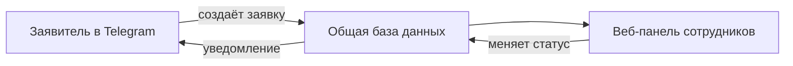

# Система обработки заявок

Прототип для учебного заведения: пользователь оставляет заявку в Telegram, а сотрудники обрабатывают её в веб-панели. Бот и панель работают с одними и теми же заявками.

## Какую проблему решает

Обращения о неисправностях и обслуживании часто теряются в чатах или передаются устно. Система превращает каждое обращение в заявку с номером, понятным статусом и историей действий.

| Было | Стало |
| --- | --- |
| Непонятно, принята ли проблема в работу | Заявитель видит номер и статус заявки |
| Сотрудникам сложно распределять обращения | В панели можно взять, назначить или переназначить заявку |
| Нельзя понять, что уже сделано | Все действия сохраняются в истории |
| О закрытии нужно сообщать вручную | Бот уведомляет заявителя об изменении статуса |

## Как это работает



1. Пользователь выбирает категорию проблемы, описывает её и оставляет контакт.
2. Бот создаёт заявку с уникальным номером.
3. Сотрудник видит её в общей ленте и берёт в работу или назначает исполнителя.
4. После решения сотрудник указывает результат и закрывает заявку.
5. Пользователь получает уведомление и может в любой момент проверить статус своей заявки.

## Возможности

### Для заявителя

- Пошаговая подача заявки с возможностью вернуться назад.
- Категории: оборудование, помещение и обслуживание — по три варианта в каждой.
- Проверка, что обязательные поля заполнены.
- Уникальный номер, список собственных заявок и просмотр статуса.
- Уведомления об изменении статуса.

### Для сотрудников

- Вход в веб-панель с ролями оператора и администратора.
- Общая лента с фильтрами по статусу, категории, исполнителю и дате.
- Статусы: **Новая → В работе → Выполнена / Отклонена**.
- Назначение, переназначение и закрытие заявок с обязательным комментарием.
- Карточка с описанием, исполнителем и полной историей действий.
- Управление сотрудниками и классификатором, статистика по заявкам.

## Технологии

| Задача | Решение |
| --- | --- |
| Серверная часть и веб-панель | Python, Django |
| Telegram-бот | aiogram |
| Хранение заявок | SQLite |
| Клиентские графики и интерактивные элементы | React, TypeScript, D3 |
| Сборка интерфейса | Vite, Tailwind CSS |
| Веб-сервер | Waitress |

## Структура проекта

```text
app/
  bot/       Telegram-диалог и уведомления
  core/      модели заявок, правила обработки и история
  web/       веб-панель сотрудников
frontend/    исходники клиентского интерфейса
tests/       автоматические проверки
docs/        требования, архитектура и материалы демонстрации
```

## Документация

- [Требования проекта](docs/requirements.md)
- [Матрица приёмки](docs/acceptance.md)
- [Архитектура и модель данных](docs/architecture.md)
- [Инструкция для оператора](docs/operator.md)
- [Сценарий демонстрации](docs/demo/scenario.md)
