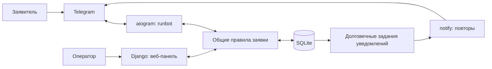

# Архитектура и решения

Выбран Python 3.12+, Django 5.2 LTS, aiogram 3 и SQLite. Django вместо предложенной связки FastAPI/SQLAlchemy объединяет серверные шаблоны, безопасные сессии, хеширование паролей, миграции и управление справочниками. Это собственное приложение, готовые тикет-системы не используются. Версии фиксируются в requirements.txt и requirements.lock.

Сущности: сотрудники Django User (оператор: is_staff, администратор: is_superuser); группа → элемент классификатора; заявка с Telegram ID владельца, снимком категории и именем заявителя; неизменяемые события истории; задания доставки; сохраняемый диалог бота. Ссылки на справочники и сотрудников защищены от удаления, в админ-панели используется отключение. Снимки категории сохраняют исходные названия после переименования.

Все активные сотрудники видят и обрабатывают все заявки. Только администратор управляет сотрудниками и классификатором, видит статистику. Неактивный сотрудник не может войти или стать новым исполнителем. Веб защищён Django sessions/CSRF, пароли — PBKDF2. Секреты берутся из окружения; локальный файл .env подключается только явно через PowerShell. Заявитель видит статус только собственных заявок.

Переходы: Новая → В работе при взятии/назначении; В работе → Выполнена или Отклонена при закрытии. Переназначение допустимо только в работе. Закрытые заявки не открываются повторно. При закрытии обязателен непустой результат. Фильтр дат — включительно по дате создания, часовой пояс Europe/Moscow.

Короткие транзакции SQLite IMMEDIATE сериализуют изменения. Изменение, история и уведомление записываются атомарно. Версия заявки защищает веб-формы от устаревших действий. Уникальный ключ подтверждения предотвращает дубли. Диалоги сохраняются в БД, команда статуса не сбрасывает подачу.

Уведомления: отдельный процесс каждые 2 секунды, запрос с таймаутом 10 секунд, ограниченные повторы до 30 секунд, очередь переживает перезапуск. Один процесс доставки; блокировка-аренда защищает от второго. Семантика at-least-once: после аварии между отправкой и фиксацией возможен дубль сообщения. Недоступность API и длинная очередь могут нарушить минутный срок; это отражается в замере и журналах доставки.

Риски, учитываемые проверками: конкурентное взятие, повтор подтверждения, отключение исполнителя, потеря процесса доставки, подмена владельца и обход ролей прямым POST. Живой Telegram и человеческое время отдельно от автоматического замера.

Официальные основания: [Django 5.2/Python](https://docs.djangoproject.com/en/5.2/releases/5.2/), [SQLite IMMEDIATE](https://docs.djangoproject.com/en/5.2/ref/databases/#sqlite-notes), [aiogram](https://docs.aiogram.dev/en/latest/).
